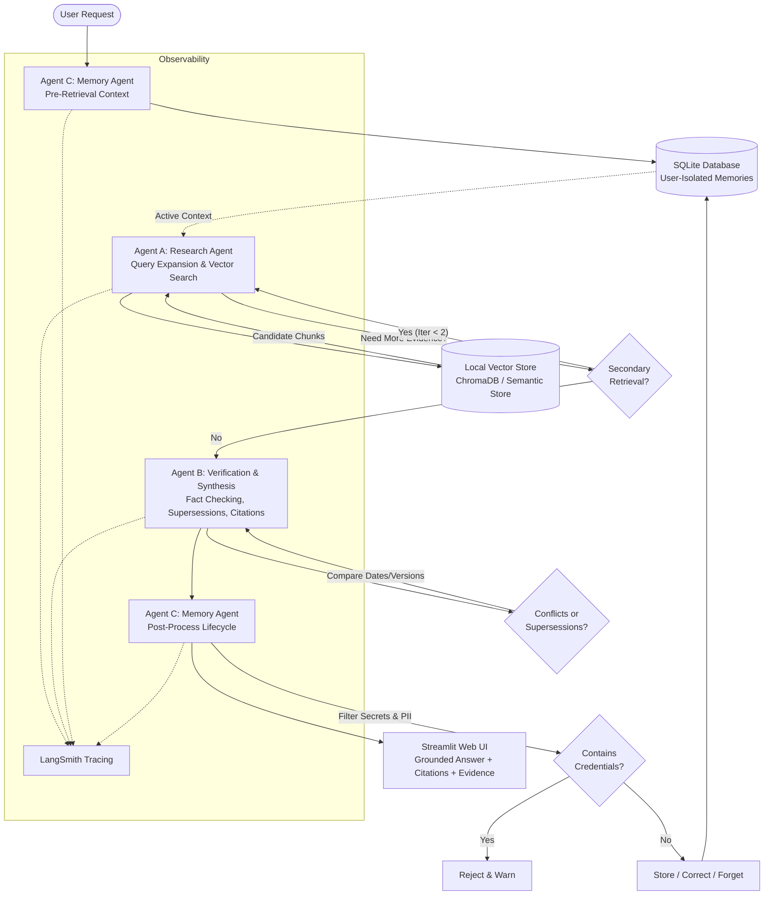

# Asterline Research Assistant — Architecture & Design Document

## 1. System Overview

The **Asterline Research Assistant** is a multi-agent system designed to help employees at Asterline Labs (a fictional workflow-monitoring software company) investigate technical issues, verify company policies, inspect release notes, and query product specifications.

The system is built upon two core pillars:
1. **Authoritative Documentary Grounding**: Every factual company answer must be strictly derived from verified corporate documentation (`corpus.jsonl`, consisting of 75 chunks across 25 documents), citing exact chunk identifiers and document titles (`[Source: chunk_id — title]`).
2. **Persistent Contextual Memory with Strict Privacy & Isolation**: Across separate conversations and full application restarts, user preferences and project context are remembered selectively, while remaining strictly isolated from corporate evidence and other users.

---

## 2. Architecture & Information Flow

The system employs a multi-agent workflow orchestrated via **LangGraph**:



---

## 3. Agent Responsibilities & Meaningful Collaboration

Rather than relying on a single monolith model call that hallucinates or blurs user opinion with corporate fact, responsibilities are cleanly divided into three distinct agents:

### Agent A: Research Agent
- **Responsibilities**:
  - Analyzes user queries with contextual awareness.
  - Generates targeted query expansions (e.g. mapping incident queries to patch release notes and scheduler specifications).
  - Searches local vector embeddings (`sentence-transformers/all-MiniLM-L6-v2` in ChromaDB).
  - Determines whether evidence is sufficient or if a bounded secondary retrieval is needed (maximum 2 iterations).

### Agent B: Verification and Synthesis Agent
- **Responsibilities**:
  - Audits candidate chunks against factual claims.
  - Resolves documentation conflicts by analyzing publication dates, semantic versions, scope, and explicit supersession language (e.g. `handbook:1` superseding older runbook figures; `retention:0` superseding the security overview).
  - Honestly detects missing evidence or unannounced roadmaps (e.g. Asia-Pacific regions, quantum encryption).
  - Enforces strict citation formatting: every factual claim must cite real, retrieved chunks: `[Source: chunk_id — title]`.

### Agent C: Memory Agent
- **Responsibilities**:
  - Scoped strictly to the active `user_id` at the storage layer.
  - Pre-retrieval: fetches active user context (e.g., preferred formatting, active project focus).
  - Post-retrieval: parses user memory commands (`remember that...`, `update/correct...`, `forget...`).
  - Privacy Safeguarding: intercepts and blocks accidental storage of API keys, bearer tokens, or sensitive credentials.
  - **Evidence Boundary**: User memories are never treated as proof of corporate facts.

---

## 4. Grounded Research & Conflict Resolution

### Conflict Resolution Hierarchy
When documentary sources disagree, the Verification Agent applies the following deterministic resolution hierarchy:
1. **Explicit Supersession Language**: If a document states `"This policy supersedes..."` or `"replacing $140"`, the superseding document takes precedence over older sources.
2. **Specific Policy vs. General Overview**: A specific, dedicated policy (e.g. *Data retention policy*) takes precedence over a broad, high-level summary (e.g. *Security overview*).
3. **Publication Date and Semantic Version**: A newer version with a later effective date takes precedence when addressing current operational guidelines.
4. **Historical Distinction**: Historical incidents (e.g. INC-2026-03 or INC-2025-12) are clearly distinguished from current operational guidance.

### Evaluated Conflict Scenarios in Asterline Documentation

| Scenario | Topic | Conflicting Documents | Verified Resolution |
| :--- | :--- | :--- | :--- |
| **B. On-Call Stipend** | Weekly on-call compensation | `handbook:1` ($175, v3, pub 2026-01-05) vs `runbook:0` ($140, v1, pub 2025-02-10) | `handbook:1` explicitly states: *"Effective 2026-01-01 the weekly on-call stipend is $175, replacing $140. This compensation update supersedes stipend figures in older operational runbooks."* |
| **C. Cold Storage Retention** | Raw run records in cold recovery | `retention:0` (20 days, v2, pub 2026-01-15) vs `security:1` (60 days, v1, pub 2025-03-15) | `retention:0` explicitly states: *"Effective 2026-01-15, raw run records are held in cold recovery storage for 20 days... This policy supersedes the 60-day figure in the security overview."* |
| **D. INC-2026-03** | Signals notification delays | `incident-03:0`, `incident-03:1`, `release-23:1`, `alerts:2` | Scheduler wall-clock backward shift skipped windows, delaying alerts up to 34 mins. Resolved by patch 2.3.1 (monotonic clock & replay). |
| **E. INC-2025-12** | Duplicate Warehouse Export rows | `incident-12:0`, `incident-12:1`, `release-21:2`, `export:1` | Heron query engine changed row order, breaking position deduplication. Fixed in patch 2.1.2 with `(export_job_id, record_hash)`. |
| **F. Asia-Pacific Region** | Regional roadmap launch date | `regions:2`, `release-22:2`, `faq:1` | Confirmed: *"No launch date or timeline has been announced for an Asia-Pacific region."* |
| **G. Quantum Computing** | Encryption algorithms | None in corpus | Confirmed: Question cannot be answered from supplied documentation. Declines without hallucination. |

---

## 5. Memory Model & Strict User Isolation

### Storage Schema
Persistent storage is implemented in SQLite (`data/asterline.db`) with relational integrity and indices:

```sql
CREATE TABLE conversations (
    id TEXT PRIMARY KEY,
    user_id TEXT NOT NULL,
    title TEXT NOT NULL,
    created_at TEXT NOT NULL,
    updated_at TEXT NOT NULL
);

CREATE TABLE messages (
    id TEXT PRIMARY KEY,
    conversation_id TEXT NOT NULL,
    user_id TEXT NOT NULL,
    role TEXT NOT NULL,
    content TEXT NOT NULL,
    citations_json TEXT,
    created_at TEXT NOT NULL,
    FOREIGN KEY (conversation_id) REFERENCES conversations(id) ON DELETE CASCADE
);

CREATE TABLE memories (
    id TEXT PRIMARY KEY,
    user_id TEXT NOT NULL,
    content TEXT NOT NULL,
    category TEXT NOT NULL DEFAULT 'general',
    confidence REAL NOT NULL DEFAULT 1.0,
    created_at TEXT NOT NULL,
    updated_at TEXT NOT NULL,
    is_active INTEGER NOT NULL DEFAULT 1,
    superseded_by TEXT
);
```

### Storage-Layer Isolation
Isolation is enforced directly inside SQLite queries:
- Every query contains `WHERE user_id = ? AND is_active = 1`.
- It is impossible for User B (Bob) to query, update, or soft-delete User A's (Alice) memories, even if User B passes Alice's `memory_id`.
- History resets and deletions are transactionally scoped to `(user_id, conversation_id)`.

### Memory Lifecycle: Creation, Correction, Forgetting
- **Creation**: Context is saved selectively based on user intent (preferences, project scope, technical constraints).
- **Correction**: Updating a memory atomically updates `content`, `category`, and `updated_at`, preventing conflicting duplicate records.
- **Forgetting**: Setting `is_active = 0` guarantees that forgotten memories are excluded from future query results.
- **Privacy Filter**: Regular expressions intercept API keys (`sk-...`, `ghp_...`, `lsv2_...`), bearer tokens, and secrets before writing to the database.

---

## 6. Observability with LangSmith

LangSmith tracing is integrated through standard environment variables and callback handlers:
- **Tracing Configuration**:
  - `LANGCHAIN_TRACING_V2=true`
  - `LANGCHAIN_API_KEY=<key>`
  - `LANGCHAIN_PROJECT=asterline-research-assistant`
- **Inspectable Events**:
  - Research Agent query formulation and candidate chunk retrieval scores.
  - Verification Agent factual audits, supersession resolutions, and citation validation.
  - Memory Agent lifecycle events (retrievals, privacy rejections, updates).
  - Redaction: Synthetic user profiles are used, and secrets are prevented from entering the trace logs.

---

## 7. Architectural Trade-offs & Limitations

1. **Local vs Cloud Embeddings**:
   - *Choice*: Local `sentence-transformers/all-MiniLM-L6-v2` with ChromaDB.
   - *Trade-off*: Zero external API cost, runs fully offline on CPU, but requires local RAM and initial vector index creation.
2. **Local LLM (Ollama) vs Hosted API vs Deterministic Engine**:
   - *Choice*: Configurable `LLMClient` supporting Ollama, OpenAI, and a built-in deterministic offline synthesizer.
   - *Trade-off*: When Ollama is offline or hardware-constrained, the deterministic engine executes exact supersession checking and citations, ensuring reproducible automated evaluations without network dependencies.
3. **Synthetic User Selector vs Production Auth**:
   - *Choice*: Session-based synthetic profile selector.
   - *Trade-off*: Suitable for local demonstrations and testing, but not a replacement for OAuth2 / OIDC in production.
