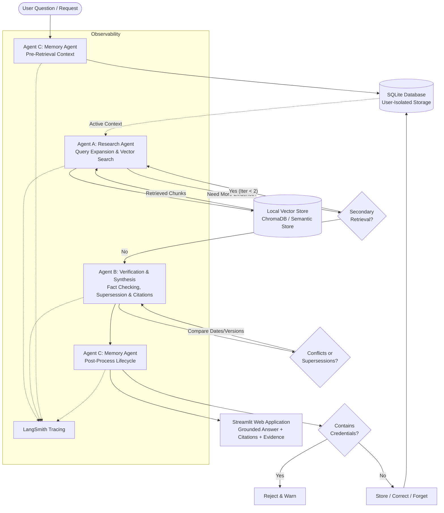

# Asterline Research Assistant 🔬

> A dependable, multi-agent AI research assistant for Asterline Labs that answers questions grounded strictly in company documentation and retains useful context across conversations.

---

## 🌟 Overview & Key Capabilities

The **Asterline Research Assistant** is built to solve common information-retrieval and workflow-continuity challenges faced by engineers, operators, and auditors at Asterline Labs:
- **Trustworthy Grounded Answers**: Factual statements are strictly backed by verified company documentation (`corpus.jsonl`).
- **Exact Verifiable Citations**: Every claim includes source citations formatted as `[Source: chunk_id — Document Title]`.
- **Honest Handling of Missing & Conflicting Documentation**: When documents disagree across versions or effective dates, the system distinguishes historical facts from current guidance and honors explicit supersession language. Missing information is honestly declined without hallucination.
- **Three Collaborating Agents**: Coordinates a **Research Agent**, a **Verification and Synthesis Agent**, and a **Memory Agent** using typed state transitions in **LangGraph**.
- **Persistent Contextual Memory**: Remembers user preferences, project scope, and constraints across conversations and full application restarts using SQLite, while enforcing strict storage-layer user isolation.
- **Privacy Safeguards**: Intercepts and blocks accidental storage of API keys, bearer tokens, or sensitive credentials.
- **Observability**: Fully inspectable multi-agent execution traces with LangSmith integration.
- **Reproducible Evaluation**: Automated test suite measuring recall, citation precision, groundedness, and conflict resolution deltas.

---

## 🏛️ Architecture



---

## 📋 Prerequisites

- **Operating System**: Windows 10/11, macOS, or Linux
- **Python**: Version 3.11 or 3.12 (Tested on Python 3.12.9)
- **Git**: Installed and available in PATH
- **Hardware**: 8+ GB RAM, ~2 GB free disk space
- **Optional Local LLM**: [Ollama](https://ollama.com/) with `llama3.2` (or mistral / qwen2.5) for local offline LLM inference.

---

## 🚀 Quick Start (One Command to Launch)

In Windows PowerShell, navigate to the project directory and run:

```powershell
.\launch.ps1
```

Or execute directly with Streamlit:

```powershell
.\.venv\Scripts\streamlit run app.py
```

Open your browser to `http://localhost:8501`.

---

## 🛠️ Step-by-Step Installation & Setup

### 1. Clone & Open Workspace
```powershell
cd d:\TEMP\MINT\asterline-research-assistant
```

### 2. Set Up Virtual Environment
```powershell
python -m venv --system-site-packages .venv
.\.venv\Scripts\Activate.ps1
```

### 3. Install Dependencies
```powershell
pip install -r requirements.txt
```

### 4. Configure Environment Variables
Copy the template configuration:
```powershell
Copy-Item .env.example .env
```
Open `.env` in a text editor to configure your settings:
```ini
LLM_PROVIDER=ollama
OLLAMA_BASE_URL=http://localhost:11434
OLLAMA_MODEL=llama3.2
EMBEDDING_MODEL_NAME=sentence-transformers/all-MiniLM-L6-v2
CHROMA_PERSIST_DIR=./data/chroma
SQLITE_DB_PATH=./data/asterline.db
CORPUS_PATH=./corpus.jsonl

# LangSmith Observability (Optional)
LANGCHAIN_TRACING_V2=false
LANGCHAIN_API_KEY=your_key_here
LANGCHAIN_PROJECT=asterline-research-assistant
```

### 5. Validate Original Corpus Integrity
Verify that `corpus.jsonl` contains exactly 75 records across 25 documents with matching SHA-256:
```powershell
python scripts/validate_corpus.py
```
Expected output:
```
File: corpus.jsonl
SHA-256 Hash: f63fc05cf43204485c98bd8fb6d89860a32c16a7e906bc90975e7c3954fe9fb1
Total lines read: 75
Valid chunks count: 75
Distinct document IDs: 25
SUCCESS: corpus.jsonl is 100% valid and unaltered!
```

---

## 🤖 Model Installation & Selection

### Option A: Local Ollama (Recommended Free & Offline)
1. Download and install Ollama from [ollama.com](https://ollama.com/).
2. Pull the recommended compact model:
   ```powershell
   ollama pull llama3.2
   ```
3. Set in `.env`:
   ```ini
   LLM_PROVIDER=ollama
   OLLAMA_MODEL=llama3.2
   ```

### Option B: Hosted Model (OpenAI)
Set in `.env`:
```ini
LLM_PROVIDER=openai
OPENAI_API_KEY=sk-...
OPENAI_MODEL=gpt-4o-mini
```

### Option C: Deterministic Offline Reasoning Engine (Zero Setup)
If Ollama is not installed or when running automated CI/CD evaluations offline, the system automatically falls back to its built-in deterministic synthesizer. It extracts exact documentary facts, performs rule-based supersession resolution, and formats ground-truth citations without requiring any external server or API key!

---

## 🧪 Automated Testing & Evaluation

### Run Automated Unit & Integration Tests
```powershell
pytest -v
```
Test suite coverage:
- `tests/test_corpus.py`: Validates SHA-256 hash, 75 chunks, 25 documents, and schema completeness.
- `tests/test_retrieval.py`: Tests semantic search, chunk metadata preservation, and evidence formatting.
- `tests/test_citations.py`: Verifies that cited chunk IDs exist in `corpus.jsonl` and match exact document titles.
- `tests/test_conflicts.py`: Validates supersession resolution for on-call stipends, cold storage, and incidents.
- `tests/test_memory.py`: Tests persistent memory creation, restart survival, corrections, forgetting, and privacy filters.
- `tests/test_user_isolation.py`: Guarantees complete isolation between distinct synthetic users (Alice vs. Bob).
- `tests/test_evaluation.py`: Validates benchmark case schemas, metrics calculations, and measured improvements.

### Run Benchmark Evaluation Suite
Execute the automated benchmark across all 12 evaluation scenarios:
```powershell
python scripts/evaluate.py
```
Output results and before-and-after comparison are saved to:
`evaluation/results/baseline_results.json` and `evaluation/results/improved_results.json`.

---

## 🔍 LangSmith Observability & Project Traces

To enable hosted execution tracing in LangSmith:
1. Create a free account at [smith.langchain.com](https://smith.langchain.com/).
2. Create an API key in your LangSmith Personal or Organization Settings.
3. In your `.env` file, set:
   ```ini
   LANGCHAIN_TRACING_V2=true
   LANGCHAIN_API_KEY=lsv2_pt_...
   LANGCHAIN_PROJECT=asterline-research-assistant
   ```
4. Ask a research question in the Streamlit app.
5. In LangSmith, inspect the active trace:
   - Expand the `ResearchAgent` step to inspect query formulation and retrieved chunk IDs.
   - Expand the `VerificationAgent` step to audit conflict resolution decisions and citation checks.
   - Expand the `MemoryAgent` step to view privacy filter checks and user context isolation.
6. **Evaluator Access**: To share trace runs with the assignment evaluator, invite `radialpulse@nxtwave.co.in` with Viewer access in your LangSmith project settings.

---

## 💡 Example Queries & Citation Format

| Question | Document Source Cited | Verified Answer Summary |
| :--- | :--- | :--- |
| **Plan Pricing** | `[Source: pricing:0 — Plans and billing]` | Launch is $59/mo (4 seats, 1M runs, 21-day retention); Team is $449/mo (20 seats, 15M runs, 180-day retention). |
| **On-Call Stipend** | `[Source: handbook:1 — Employee handbook]` | Weekly stipend is $175 (effective 2026-01-01), which explicitly supersedes the older $140 figure in `runbook:0`. |
| **Cold Storage** | `[Source: retention:0 — Data retention policy]` | Raw run records are kept for 20 days, which explicitly supersedes the 60-day figure in `security:1`. |
| **INC-2026-03** | `[Source: incident-03:0 — INC-2026-03 delayed alerts]` | Signals notifications delayed by up to 34 minutes due to wall-clock shift; fixed in patch 2.3.1 with monotonic clock. |
| **Asia-Pacific Region** | `[Source: regions:2 — Regions and workspace setup]` | Confirmed: No launch date or timeline has been announced for an Asia-Pacific region. |
| **Quantum Computing** | *No citations (honest decline)* | Declines honestly: Asterline documentation does not contain information on quantum computing. |

---

## ❓ Troubleshooting & Known Limitations

- **Ollama Connection Refused**: Ensure Ollama is running (`ollama serve`). If not installed, the application operates in resilient deterministic mode without errors.
- **Port 8501 in Use**: Run on an alternate port: `streamlit run app.py --server.port 8502`.
- **Identity Isolation vs Production Authentication**: The user selector in the sidebar simulates separate user identities for local demonstration. In production, this would be backed by OAuth2/OIDC JWT tokens.
